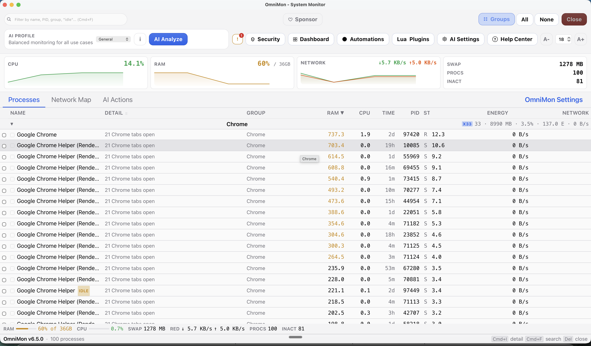

# OmniMon

[](https://github.com/CAPDESIS/omnimon/actions) [](#) [](#) [](#) [](#) [](LICENSE) [](https://github.com/sponsors/chochy2001)

> **Release status (2026-11-15):** Workspace manifests (`v4/Cargo.toml`, `v4/apps/desktop/package.json`, `v4/apps/desktop/src-tauri/tauri.conf.json`) are at **6.8.1**, and GitHub Release **[`v6.8.1`](https://github.com/CAPDESIS/omnimon/releases/tag/v6.8.1)** is **Latest** (published `2026-11-05`) with `OmniMon-6.8.1-macOS-Universal.dmg`, `OmniMon-6.8.1-Windows.msi`, Linux `.AppImage` / `.deb` / `.rpm`, `.sig.json` signatures, `releases.json`, and `SHA256SUMS.txt`. The Homebrew cask in [`distribution/homebrew/omnimon.rb`](distribution/homebrew/omnimon.rb) remains pinned at **6.8.0** pending the `6.8.1` Universal DMG `sha256` bump.

```
  ___  __  __ _   _ ___ __  __  ___  _   _
 / _ \|  \/  | \ | |_ _|  \/  |/ _ \| \ | |
| | | | |\/| |  \| || || |\/| | | | |  \| |
| |_| | |  | | |\  || || |  | | |_| | |\  |
 \___/|_|  |_|_| \_|___|_|  |_|\___/|_| \_|
```

*Scroll down for Spanish / Desplazate hacia abajo para Espanol.*



OmniMon is a cross-platform system monitor built with Rust, Tauri, and Svelte. It provides real-time process telemetry, AI-assisted optimization, network security analysis, and browser tab management from a desktop app, CLI, or TUI.

## Tech Stack

- **Rust workspace (`v4/Cargo.toml`, `6.8.1`)**: Rust edition `2021` (CI toolchain `1.97.1`), `sysinfo 0.30`, `tokio 1`, `reqwest 0.13`, `keyring 3`, `aes-gcm 0.10`, `ed25519-dalek 2`, `pcap 1` (macOS), `aya 0.13` (Linux eBPF), `ratatui 0.30`, `clap 4.5`
- **Desktop host & UI (`v4/apps/desktop/`, `6.8.1`)**: Tauri `2.12.4`, Svelte `5.57.3`, TypeScript `7.0.2`, Vite `8.1.6`, Bun `1.3.x` (`1.3.14` in CI), Vitest `4.1.12`, Playwright `1.64.1`
- **AI standard**: **OpenRouter** preferred fleet AI standard (direct `api.openai.com` removed; enforced by `scripts/openrouter-only-validate.py`)

## Highlights

- **Real-time system monitoring** - CPU, memory, disk I/O, network throughput, and energy impact per process with 2-second refresh
- **AI-powered optimization** - Prefer **OpenRouter** (Capdesis fleet product AI standard, incl. `openai/...` models); desktop also has optional BYO-key paths (Anthropic, Gemini, Ollama) that are not the fleet product standard
- **Network intelligence** - Native packet capture (`pcap`/eBPF/Win32), connection analysis, DNS enrichment, and MITRE ATT&CK correlation
- **Browser tab control** - List, close, and focus tabs across Chrome, Safari, Brave, Edge, Arc, and Firefox via CDP, AppleScript, and Windows UI Automation
- **Security & compliance** - CVE auditing, NIST SP 800-53 heartbeats, AES-256-GCM audit helpers, Ed25519 release signing
- **User profiles** - Preset configurations with customizable dashboard layouts, refresh intervals, and favorite processes
- **SRE automations** - User-defined rules for alerts and auto-actions with native OS notifications
- **Plugin system** - Extend monitoring with Lua plugins (`mlua`, restricted stdlib, 150ms timeout, 1MB memory limit; not a security sandbox)
- **Three interfaces** - Desktop GUI (`omnimon-desktop`), CLI (`cli`), and interactive TUI (`omnimon-tui`)
- **macOS Memory Guard** - Optional LaunchAgent (`tools/macos-memory-guard/`) that reaps idle leftovers without touching Warp, Chrome, agent CLIs, or `fseventsd`
- **Kill identity** - Desktop, CLI, and TUI kills target `(pid, start_time)`, not PID alone, so a recycled PID is not force-killed

## Directory Layout

```
omnimon/
├── v4/
│   ├── Cargo.toml                  # Workspace (core, cli, tui, omnimon-desktop; v6.8.1)
│   ├── Makefile                    # Dev & release test shortcuts
│   ├── crates/
│   │   ├── core/                   # Shared Rust telemetry, network, AI, security, crypto
│   │   ├── cli/                    # OmniMon CLI binary
│   │   └── tui/                    # Interactive terminal UI (ratatui)
│   └── apps/desktop/               # Svelte 5.57.3 + Vite 8.1.6 + Tauri 2.12.4 app
│       ├── package.json            # Frontend dependencies & scripts (Bun)
│       ├── src/                    # Svelte components, stores, IPC client, tests
│       ├── e2e/                    # Playwright E2E specs
│       └── src-tauri/              # Tauri Rust host & tauri.conf.json
├── tools/macos-memory-guard/       # Optional macOS LaunchAgent & classifier selftest
├── scripts/                        # CI, OpenRouter guard, CVE report, release signing scripts
├── distribution/homebrew/          # Homebrew cask definition (omnimon.rb, currently 6.8.0)
├── docs/                           # Architecture, CLI manual, roadmap, fleet status, audits
├── .github/workflows/              # omnimon-ci.yml and release-policy.yml
└── omnimon_landing/                # Gitignored nested checkout (chochy2001/omnimon_landing)
```

## Quick Start

### macOS (Homebrew)

```bash
brew tap chochy2001/omnimon
brew install --cask omnimon
```

The app launches automatically after install. Find it in **Spotlight** (`Cmd + Space` -> "OmniMon") or in `/Applications/OmniMon.app`. Note: the Homebrew cask currently points to `v6.8.0` until `distribution/homebrew/omnimon.rb` is bumped to the `v6.8.1` Universal DMG; download the `v6.8.1` `.dmg` directly from [GitHub Releases](https://github.com/CAPDESIS/omnimon/releases/tag/v6.8.1) if you want `6.8.1` immediately.

### Windows

Download `OmniMon-6.8.1-Windows.msi` from the [latest release](https://github.com/CAPDESIS/omnimon/releases/latest).

### Linux

```bash
# Debian/Ubuntu - one-liner
curl -fsSL https://raw.githubusercontent.com/CAPDESIS/omnimon/main/scripts/install-web.sh | bash

# Or download .deb / .AppImage / .rpm from the latest release
```

### Build from Source

```bash
git clone https://github.com/CAPDESIS/omnimon.git
cd omnimon/v4
./setup-dev.sh   # Installs Rust, bun, Tauri CLI, OS deps
make dev         # Launches dev mode (Vite + Tauri hot-reload)
```

## Usage

### Desktop GUI

Launch OmniMon from your applications menu or system tray. The app runs in the background with a tray icon.

### CLI

```bash
omnimon status                                    # System overview
omnimon status --format json                      # Machine-readable output
omnimon optimize --ai openrouter --target browsers # AI optimization
omnimon network --top                             # Network throughput
omnimon network --connections --filter tcp        # TCP connections
omnimon network --alerts --watch                  # Live alert stream
omnimon chat --ai openrouter "What is using the most RAM?"
omnimon security-scan --cve-db ./cves.json        # CVE audit
omnimon rules list                                # Security rules
omnimon release sign --version 6.8.1 ./omnimon    # Sign binary
omnimon doctor                                    # Health check
```

### TUI (Terminal UI)

```bash
omnimon tui
```

Interactive htop-style dashboard with process table, system gauges, and built-in AI chat. Keyboard-driven: `s` to sort, `K` to kill, `Tab` to switch panels.

## AI Providers

Capdesis fleet product AI standard is **OpenRouter only** (server-side proxy in cloud products; desktop: prefer OpenRouter user key). Do not treat direct `api.openai.com` / `OPENAI_API_KEY` as the product default.

| Provider | Model (default) | API Key Required | Notes |
|----------|----------------|-----------------|-------|
| **OpenRouter** | llama-3.2-3b (free) | Yes | **Preferred** fleet path (incl. `openai/...` models) |
| Anthropic | claude-haiku-4-5 | Yes | Optional desktop BYO-key residual |
| Gemini | gemini-2.0-flash | Yes | Optional desktop BYO-key residual |
| Ollama | llama3.2 (local) | No | Local only |

Direct OpenAI (`api.openai.com`) is removed fleet-wide: use OpenRouter with an `openai/...` model slug instead. Stored `openai` configs migrate automatically.

Store keys securely: `omnimon apikey --ai <provider> <key>` (stored in OS Keyring).

## Test, Lint, and CI

### Local Validation Commands

From `v4/`:

```bash
cargo fmt --check
cargo clippy --workspace --all-targets -- -D warnings
cargo test --workspace -- --test-threads=1
```

From `v4/apps/desktop/`:

```bash
bun install --frozen-lockfile
bun run typecheck
bun run test
bun run test:coverage
bun run build
bun run test:e2e
```

From the repository root:

```bash
python3 scripts/openrouter-only-validate.py --root . --app omnimon
python3 scripts/test_cve_report.py
python3 scripts/test_release_pipeline.py -v
bash scripts/test-release-policy-lib.sh
bash tools/macos-memory-guard/memory-guard.sh selftest
```

### CI/CD Workflows

- [`.github/workflows/omnimon-ci.yml`](.github/workflows/omnimon-ci.yml): Public-repo GitHub-hosted workflow (`ubuntu-latest`, plus `macos-latest` and `windows-latest` on `workflow_dispatch` / releases). Enforces `rustfmt`, `clippy --all-targets -D warnings`, `cargo test --workspace`, `bun run typecheck`, `bun run test`, `bun run build`, Vitest coverage (`>= 85%` lines/functions/statements, `>= 70%` branches), RAW Rust workspace `cargo llvm-cov` (`>= 85%` lines), `openrouter-only-validate.py`, `memory-guard.sh selftest`, `test_release_pipeline.py`, `cargo audit`, `bun audit`, Playwright E2E, Ed25519 signing preflight, and multi-OS release builds.
- [`.github/workflows/release-policy.yml`](.github/workflows/release-policy.yml): Validates release workflow hygiene and runner isolation (`ubuntu-latest` for public repo) on daily schedule and `workflow_dispatch`.

## Documentation

| Document | Description |
|----------|-------------|
| [Fleet Status](docs/FLEET_STATUS.md) | Current release, main SHAs, landing parity, and open items |
| [Architecture](docs/ARCHITECTURE.md) | System architecture, data flow, and design decisions |
| [CLI Manual](docs/CLI_MANUAL.md) | Complete CLI reference with all commands and options |
| [Network Analysis](docs/NETWORK_ANALYSIS.md) | Network capture, alerts, and CLI workflows |
| [Commands Reference](COMMANDS_REFERENCE.md) | AI chat actions, CLI commands, and IPC catalog |
| [Roadmap](docs/ROADMAP.md) | Product roadmap and verified milestone status |
| [Contributing](CONTRIBUTING.md) | Development setup, PR guidelines, and conventions |
| [Changelog](CHANGELOG.md) | Version history |
| [Security](SECURITY.md) | Security policy and vulnerability reporting |
| [NIST Compliance](NIST_COMPLIANCE.md) | NIST SP 800-53 controls mapping |
| [CVE Report](CVE_REPORT.md) | Automated dependency CVE tracking |
| [Agent Guide](AGENTS.md) | Repository layout, commands, and agent rules |
| [Claude Instructions](CLAUDE.md) | Project rules, UI opacity ban, and infrastructure notes |

## Architecture Overview

```
+--------------------------------------------------------+
|                    Tauri Desktop App                   |
|  +----------------------+  +-------------------------+ |
|  |   Svelte 5 Frontend  |  |   Rust Backend (Tauri)  | |
|  |  +----------------+  |  |  +------------------+   | |
|  |  | Stores/State   |<-+--+->| IPC Commands     |   | |
|  |  | Components     |  |  |  | Automations      |   | |
|  |  | Virtual Scroll |  |  |  | Plugins (Lua)    |   | |
|  |  +----------------+  |  |  +--------+---------+   | |
|  +----------------------+  +-----------|-------------+ |
+----------------------------------------|---------------+
                                         |
+----------------------------------------v--------------+
|                   macmon_core (Rust)                  |
|  +---------+ +---------+ +----------+ +------------+  |
|  | metrics | | network | | security | |     ai     |  |
|  | watcher | | analysis| | audit    | | rules_eng. |  |
|  | killer  | | alerts  | | crypto   | | browser    |  |
|  +---------+ +---------+ +----------+ +------------+  |
+-------------------------------------------------------+
```

Four Cargo workspace crates in `v4/`: `core` (`macmon_core`), `cli`, `omnimon-tui`, and `omnimon-desktop` (Tauri).

See [docs/ARCHITECTURE.md](docs/ARCHITECTURE.md) for the full architecture document.

## License

[MIT](LICENSE)

## Support and Sponsorship

OmniMon is open-source software under the MIT license. Free to compile from source for personal use. To support development or get pre-built installers and premium support:

**[Sponsor OmniMon on GitHub Sponsors](https://github.com/sponsors/chochy2001)**

---

# OmniMon (Espanol)

OmniMon es un monitor de sistema multiplataforma construido con Rust, Tauri y Svelte. Proporciona telemetria de procesos en tiempo real, optimizacion asistida por IA, analisis de seguridad de red y gestion de pestanas del navegador desde una app de escritorio, CLI o TUI.

> **Estado de release (2026-11-15):** Los manifiestos del workspace estan en **6.8.1** y el release **[`v6.8.1`](https://github.com/CAPDESIS/omnimon/releases/tag/v6.8.1)** esta publicado como **Latest** (`2026-11-05`) en GitHub Releases con instaladores para macOS (`.dmg` universal), Windows (`.msi`), Linux (`.AppImage`, `.deb`, `.rpm`), `releases.json`, `SHA256SUMS.txt` y firmas `.sig.json`. El cask de Homebrew en [`distribution/homebrew/omnimon.rb`](distribution/homebrew/omnimon.rb) sigue en **6.8.0** pendiente de actualizar el `sha256` del DMG `6.8.1`.

## Caracteristicas

- **Monitoreo en tiempo real** - CPU, memoria, disco, red y consumo energetico por proceso con refresco de 2 segundos
- **Optimizacion con IA** - Preferir **OpenRouter** (estandar flota Capdesis); rutas desktop BYO-key opcionales no son el estandar de producto
- **Inteligencia de red** - Captura nativa (`pcap`/eBPF/Win32), analisis de conexiones, DNS y correlacion MITRE ATT&CK
- **Control de pestanas** - Listar, cerrar y enfocar pestanas en Chrome, Safari, Brave, Edge, Arc y Firefox
- **Seguridad y cumplimiento** - Auditoria CVE, heartbeats NIST SP 800-53, utilidades AES-256-GCM, firma Ed25519
- **Perfiles de usuario** - Presets configurables con layouts de dashboard, intervalos de refresco y procesos favoritos
- **Automatizaciones SRE** - Reglas definidas por el usuario para alertas y acciones automaticas
- **Sistema de plugins** - Extiende el monitoreo con plugins Lua (stdlib restringida, 150ms, 1MB; no es un sandbox de seguridad)
- **Tres interfaces** - GUI de escritorio (`omnimon-desktop`), CLI (`cli`) e interfaz TUI interactiva (`omnimon-tui`)
- **macOS Memory Guard** - LaunchAgent opcional (`tools/macos-memory-guard/`) que cierra leftovers idle sin tocar Warp, Chrome ni `fseventsd`
- **Identidad al matar** - Escritorio, CLI y TUI usan `(pid, start_time)`, no el PID solo

## Inicio Rapido

### macOS (Homebrew)

```bash
brew tap chochy2001/omnimon
brew install --cask omnimon
```

Nota: el cask de Homebrew sigue apuntando a `6.8.0` hasta actualizar el `sha256` del DMG `6.8.1`; para instalar `6.8.1` hoy, descarga el `.dmg` directo desde [GitHub Releases](https://github.com/CAPDESIS/omnimon/releases/tag/v6.8.1).

### Windows

Descarga `OmniMon-6.8.1-Windows.msi` desde el [ultimo release](https://github.com/CAPDESIS/omnimon/releases/latest).

### Linux

```bash
# Debian/Ubuntu
curl -fsSL https://raw.githubusercontent.com/CAPDESIS/omnimon/main/scripts/install-web.sh | bash

# O descarga .deb / .AppImage / .rpm desde el ultimo release
```

### Compilar desde el Codigo Fuente

```bash
git clone https://github.com/CAPDESIS/omnimon.git
cd omnimon/v4
./setup-dev.sh
make dev
```

## Uso del CLI

```bash
omnimon status                                     # Vista general del sistema
omnimon status --format json                       # Salida estructurada
omnimon optimize --ai openrouter --target browsers # Optimizacion con IA
omnimon network --top                              # Throughput de red
omnimon chat --ai openrouter "Que esta usando mas RAM?"
omnimon security-scan                              # Auditoria de seguridad
omnimon doctor                                     # Diagnostico del sistema
```

## Proveedores de IA

Estandar de IA de producto Capdesis: **solo OpenRouter**. No usar `OPENAI_API_KEY` / `api.openai.com` como default de producto.

| Proveedor | Modelo (default) | Requiere API Key | Notas |
|-----------|-----------------|-----------------|-------|
| **OpenRouter** | llama-3.2-3b (gratis) | Si | **Preferido** (incl. modelos `openai/...`) |
| Anthropic | claude-haiku-4-5 | Si | Residual desktop BYO-key |
| Gemini | gemini-2.0-flash | Si | Residual desktop BYO-key |
| Ollama | llama3.2 (local) | No | Solo local |

OpenAI directo (`api.openai.com`) se elimino en toda la flota: usa OpenRouter con un slug de modelo `openai/...`. Las configs `openai` guardadas migran solas.

Guarda claves de forma segura: `omnimon apikey --ai <proveedor> <clave>` (almacenado en Keyring del OS).

## Documentacion

| Documento | Descripcion |
|-----------|-------------|
| [Estado de Flota](docs/FLEET_STATUS.md) | Release publicado, SHAs de main y estado actual |
| [Arquitectura](docs/ARCHITECTURE.md) | Arquitectura del sistema y flujo de datos |
| [Manual CLI](docs/CLI_MANUAL.md) | Referencia completa del CLI |
| [Analisis de Red](docs/NETWORK_ANALYSIS.md) | Captura de red, alertas y workflows |
| [Referencia de Comandos](COMMANDS_REFERENCE.md) | Acciones AI, comandos CLI y catalogo IPC |
| [Roadmap](docs/ROADMAP.md) | Hoja de ruta y estado verificado |
| [Contribuir](CONTRIBUTING.md) | Setup de desarrollo y convenciones |

## Licencia

[MIT](LICENSE)

## Apoyo y Patrocinio

OmniMon es software de codigo abierto bajo licencia MIT. Gratis para compilar desde la fuente. Para apoyar el desarrollo u obtener instaladores pre-compilados y soporte premium:

**[Patrocina OmniMon en GitHub Sponsors](https://github.com/sponsors/chochy2001)**
